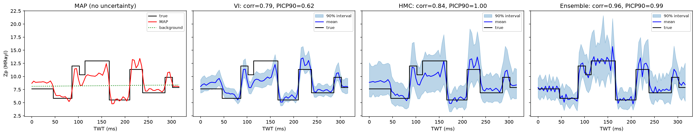
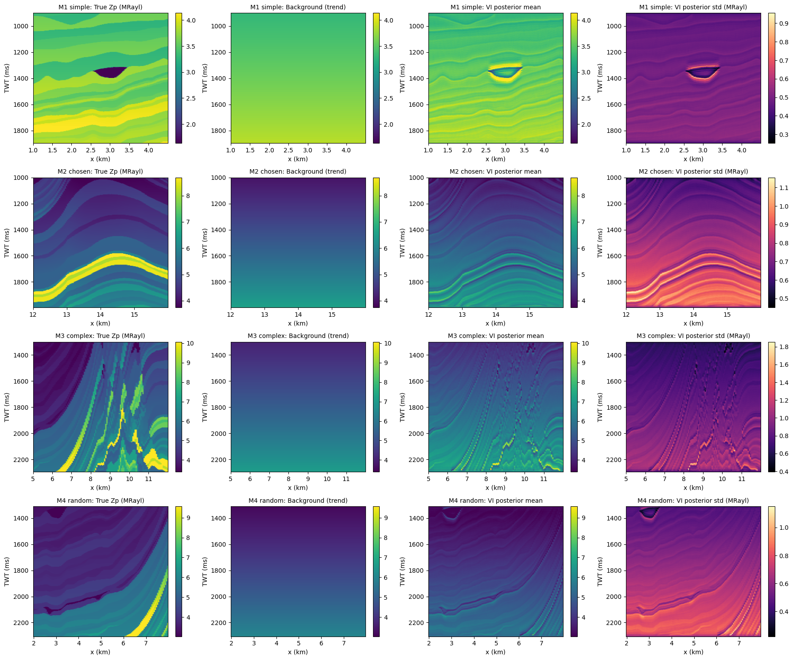

# Well-Free Acoustic Impedance Inversion with Bayesian Physics-Informed Neural Networks (B-PINN)

> **Status: work in progress** (Master's research, Institut Teknologi Sepuluh Nopember). Results below are preliminary and not peer-reviewed.

## Problem

Acoustic impedance (Zp) is normally estimated from post-stack seismic data using well logs as constraints. This project asks whether Zp can be estimated **without well control** on post-stack 2D seismic data, and whether the **uncertainty** of that estimate can be quantified.

## Approach

- Forward model: zero-offset convolutional model on m = ln Zp. Reflectivity is r = 0.5 dm/dt (centred difference), convolved with a zero-phase Ricker wavelet (25 Hz, ±64 ms), so d = G m with G = C D. The physics term is the data misfit ||d_obs − G m̃||² / (2σ_d²) inside the loss (σ_d = 10% of the seismic standard deviation), so **no impedance label enters training**. Synthetic data are generated on a grid at dt/2 and decimated before inversion, so that the data and inversion operators differ (no inverse crime). The low-frequency background m_LF is a straight-line trend of ln Zp versus time, added to the network output.
- Network: the network outputs a correction Δ ln Zp that is added to the background, m̃ = m_LF + Δm.
  - 1D test (E1): fully connected, one hidden layer of 16 tanh units, input = one normalised trace (80 samples), output = 80 samples (2,656 parameters).
  - 2D tests (Marmousi2 and field line): three-layer 1D convolutional network (8 channels, kernel 11, tanh, tanh, linear; 897 parameters; receptive field 31 samples = 124 ms), shared by all traces. Input = the normalised seismic trace; each window is 120 traces × 250 samples at 4 ms.
- Uncertainty quantification (compared):
  - Variational inference (main method): mean-field Gaussian over weights, trained by maximising the ELBO (data misfit + closed-form KL to a N(0, 0.1²) prior).
  - Hamiltonian Monte Carlo (1D reference only)
  - Deep ensembles (baseline, 1D only)
- Planned extensions: lithology and total porosity via rock-physics relations (not implemented yet).

## Experiments in this repository

| Script | What it does | Data |
|---|---|---|
| `e1_bpinn_1d.py` | 1D synthetic test, single run (seed 0): MAP vs VI vs HMC vs deep ensemble on one blocky impedance trace; reports correlation, MAE, PICP90 and 90% interval width | Synthetic, generated inside the script (no download) |
| `e1_bpinn_1d_5seeds.py` | Same as E1 repeated over 5 random seeds (0–4) to check stability; prints mean ± std | Synthetic, generated inside the script (no download) |
| `marmousi2_four_windows.py` | 2D test on four Marmousi2 windows (M1 simple, M2 anticline, M3 faulted, M4 random with seed 2026). Baseline (E2) for all windows; E3 and E4 sensitivity tests on M1 and M3. MAP + VI, seed 0 | Marmousi2 (public); you provide the two SEG-Y files |
| `window_b_e2_e3_e4.py` | One Marmousi2 window (x 1–4.5 km, TWT 0.9–1.9 s, the same region as M1). E2: baseline with correct background and wavelet. E3: background wrong (shifted ±0.10 in ln Zp, about ±10% impedance, and slope × 1.3). E4: wavelet wrong (data use 25 Hz, inversion assumes 20 Hz or 30 Hz) | Marmousi2 (public); you provide the two SEG-Y files |
| `field_line_four_windows.py` | Application of the same network and inference to four windows of one 2D post-stack field line from the South Java Sea. Same VI workflow as the Marmousi2 tests; the true impedance is unknown, so the background trend is estimated from the data | One 2D post-stack field line, used with permission of the data owner; the raw file is **not** distributed with this repository (see Data note) |

All 2D scripts import the shared code from `bpinn_core.py` (forward model, 1D CNN, MAP, VI, metrics). The two E1 scripts are self-contained. Each script is written as VS Code "cells" (`# %%`), so it can be run cell by cell in the Interactive Window or as a normal Python script.

## Results (preliminary)

All numbers below are produced by the scripts in this repository.

**1D reference test (E1, 5 seeds, mean ± std).** VI is compared with HMC (reference posterior) and a deep ensemble. MAE and width are in MRayl.

| Method | Correlation | MAE | PICP90 (ideal 0.90) | 90% interval width |
|---|---|---|---|---|
| MAP | 0.92 ± 0.04 | 0.69 ± 0.23 | – | – |
| VI | 0.86 ± 0.04 | 0.91 ± 0.23 | 0.70 ± 0.17 | 2.31 ± 0.31 |
| HMC | 0.90 ± 0.04 | 0.79 ± 0.22 | 1.00 ± 0.00 | 5.93 ± 0.19 |
| Deep ensemble | 0.96 ± 0.01 | 0.48 ± 0.08 | 0.99 ± 0.01 | 5.04 ± 0.23 |

VI intervals are about 2.6 times narrower than the HMC reference and cover the true impedance only 70% of the time at the nominal 90% level (0.51 to 0.96 across seeds), so VI is overconfident in this test.


*E1, seed 0: true impedance (black), estimate and 90% interval for MAP, VI, HMC and the deep ensemble.*

**2D test on Marmousi2 (VI, seed 0, correct background and wavelet).** BG MAE is the error of the background trend alone. `rho_hp` is the correlation of the high-frequency part (layer detail). MAE and width are in MRayl.

| Window | Correlation | MAE (BG MAE) | rho_hp | PICP90 | 90% width |
|---|---|---|---|---|---|
| M1 simple | 0.631 | 0.148 (0.162) | 0.78 | 0.98 | 1.65 |
| M2 anticline | 0.733 | 0.506 (0.528) | 0.69 | 0.93 | 2.45 |
| M3 faulted | 0.672 | 0.875 (0.873) | 0.76 | 0.75 | 2.68 |
| M4 random | 0.760 | 0.574 (0.539) | 0.76 | 0.90 | 2.00 |


*Rows: M1–M4. Columns: true Zp, background, VI posterior mean, VI posterior standard deviation.*

What the results show so far:
- Layer detail is recovered in all four windows (rho_hp 0.69–0.78).
- The absolute level follows the assumed background: MAE is not consistently better than the background alone (equal in M3, worse in M4), and a background shifted by ±10% raises the VI MAE in M1 from 0.148 to 0.35–0.41 MRayl without changing the correlation.
- A wavelet frequency assumed too low (20 Hz) degrades the detail (rho_hp 0.83 → 0.62 in M1); too high (30 Hz) keeps the detail but worsens VI MAE and calibration in the faulted window (MAE 0.875 → 1.031, PICP90 0.75 → 0.67).

**Field line.** The field script applies the same workflow to one 2D post-stack line. Because no well is available to check the result, it is a feasibility test: only the plausibility of the layer detail and of the uncertainty sections can be judged, not the absolute error.

## Reproducing

1. Create an environment and install the dependencies (Python 3.10+; a CPU is sufficient, everything runs in float64 on CPU and no GPU is needed):

   ```bash
   python -m venv .venv
   source .venv/bin/activate          # Windows: .venv\Scripts\activate
   pip install -r requirements.txt
   ```

2. Open the folder in VS Code with the Python and Jupyter extensions, select the `.venv` interpreter, and either click **Run Cell** above each `# %%` block (results appear in the Interactive Window), or run a whole script from the terminal, for example `python e1_bpinn_1d_5seeds.py`. Use `MPLBACKEND=Agg` to run without opening figure windows.
3. Data:
   - E1 scripts: nothing to download, the synthetic data are generated inside the script.
   - Marmousi2 scripts: download the public Marmousi2 model (Martin et al., 2006) and put `MODEL_P-WAVE_VELOCITY_1.25m.segy` and `MODEL_DENSITY_1.25m.segy` in the `data/` folder (git-ignored). The names in the config cell (`VP_FILE`, `RHO_FILE`) must match. Do not set `QUICK = True` for real results: it switches to a synthetic stand-in model and is only a smoke test.
   - Field script: the field line is not distributed here. To run it, put a 2D post-stack SEG-Y file of your own in `data/` (or set the `FIELD_SGY` environment variable to its path).
4. Outputs (figures, `.json`, `.npz`) are written to `outputs/<script name>/` (git-ignored). Approximate runtime on a CPU:
   - `e1_bpinn_1d.py`: a few minutes.
   - `e1_bpinn_1d_5seeds.py`: about 10–25 minutes (5 seeds).
   - `window_b_e2_e3_e4.py`: about 1–1.5 hours.
   - `marmousi2_four_windows.py`: about 3 hours for all 14 runs (about 50 minutes with `VARIANT_WINDOWS = []`).

Dependencies: see `requirements.txt` (PyTorch, NumPy, SciPy, Matplotlib, `segyio`). Random seeds are set in each script.

## Limitations

- Validated primarily on synthetic data. The field application covers one 2D line without well control, so it is a feasibility test rather than a validation.
- Without well control the result is non-unique; the uncertainty estimates reflect the model and prior, not necessarily the true error.
- The synthetic data are 1D convolutional synthetics (not wave-equation simulations) with zero-phase wavelets; multiples, attenuation and wavelet phase errors are not modelled.
- In the synthetic tests the background is a straight line fitted to the true model, an idealisation that is not available in practice. On the field line the background is estimated from the data and its error cannot be measured. The uncertainty of the background is not included in the intervals, so a wrong background shifts the result without widening the interval.
- Absolute impedance follows the assumed background; only layer detail is informed by the data.
- VI under-estimates the posterior spread (PICP90 0.70 in the 1D test, 0.75 in the faulted Marmousi2 window); HMC is feasible only in 1D.
- The Marmousi2 results use one seed (seed 0) and four windows; the 1D test uses 5 seeds.

## Data note

- Synthetic data are generated by the scripts and are not stored in this repository.
- Marmousi2 is a public synthetic model (Martin et al., 2006). It is not redistributed here; download it from its original source and follow its terms of use.
- The field example uses one 2D post-stack seismic line from the South Java Sea, used for thesis research. The raw seismic file is not redistributed in this repository, and `.sgy`/`.segy` files are excluded through `.gitignore`.

## References

- Martin, G. S., Wiley, R., and Marfurt, K. J., 2006, Marmousi2: An elastic upgrade for Marmousi: The Leading Edge, 25(2), 156–166.
- Raissi, M., Perdikaris, P., and Karniadakis, G. E., 2019, Physics-informed neural networks: A deep learning framework for solving forward and inverse problems involving nonlinear partial differential equations: Journal of Computational Physics, 378, 686–707.
- Blundell, C., Cornebise, J., Kavukcuoglu, K., and Wierstra, D., 2015, Weight uncertainty in neural networks: Proceedings of the 32nd International Conference on Machine Learning (ICML).
- Neal, R. M., 2011, MCMC using Hamiltonian dynamics: in Handbook of Markov Chain Monte Carlo, Chapman and Hall/CRC.
- Lakshminarayanan, B., Pritzel, A., and Blundell, C., 2017, Simple and scalable predictive uncertainty estimation using deep ensembles: Advances in Neural Information Processing Systems (NeurIPS) 30.

## Author

Mirza Amanda Azzahra, Master's student, Geophysical Engineering, ITS. Contact: mirzaamanda1102@gmail.com
